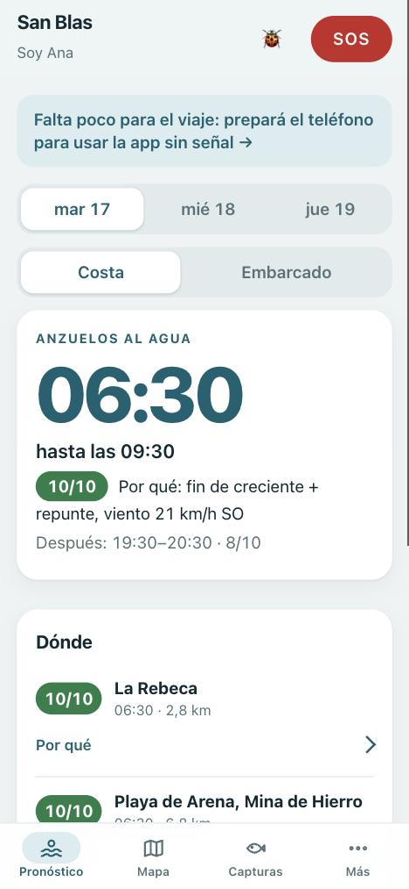
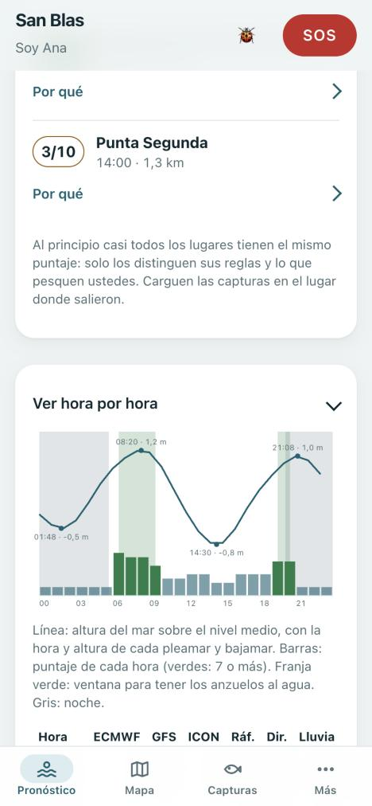
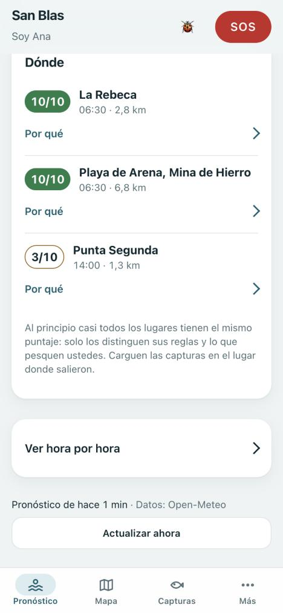
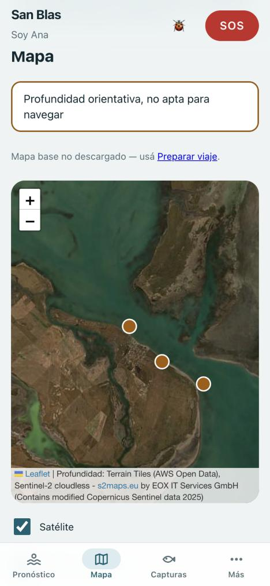

# App de Pesca

Web app (PWA) para que un grupo de amigos planifique y registre sus viajes de pesca. Responde la pregunta que importa en la orilla: **a qué hora tener los anzuelos en el agua, cuánto dura la ventana y dónde conviene ir**, según marea (o altura del río), viento, luz y luna.

Funciona **sin señal**: antes de salir, "Preparar viaje" guarda en el teléfono el pronóstico, el mapa, la profundidad, la imagen satelital y los datos del grupo.

<p>
  
  
  
  
</p>

## Qué hace

- **Pronóstico por hora:** puntaje de 0 a 10, la mejor ventana del día con su motivo ("fin de creciente + repunte, viento 21 km/h SO"), curva de marea con pleamares y bajamares, y el viento de tres modelos (ECMWF, GFS, ICON) lado a lado para ver cuándo no coinciden. Modo costa y modo embarcado.
- **Mar y río:** en el mar usa la marea de Open-Meteo; en el río usa la altura medida y pronosticada por el INA (por ejemplo, Zárate en el Paraná de las Palmas).
- **Dónde pescar:** ordena los pesqueros cercanos con puntaje y un "por qué", combinando el pronóstico con las reglas de cada lugar y lo que el grupo ya pescó ahí.
- **Mapa offline:** mapa base de OpenStreetMap, capa de profundidad, imagen satelital, "Marcar punto" e "Ir a punto" con distancia y rumbo. Los sondeos del grupo se corrigen por la marea del momento.
- **Capturas:** especie, medida y foto; la app agrega sola la hora, el lugar, la marea y el viento. Ranking del grupo y capturas por fase de marea.
- **Especies y reglamento:** medidas mínimas, cupos y devoluciones obligatorias de Buenos Aires y Entre Ríos, cada dato con su fuente.
- **Checklist e itinerario** compartidos.
- **Emergencias:** posición GPS en grados y minutos para leer por radio, Prefectura 106 y VHF canal 16. Anda sin internet.

## Cómo está pensada

- **Sin cuentas.** Crear un viaje genera un link `/t/<uuid>`; quien tiene el link entra y elige "¿Quién sos?". Las políticas RLS de Supabase solo dejan leer o editar un viaje si el pedido trae su UUID en el header `x-trip-id`. Límite asumido: cualquiera con el link puede editar.
- **Crear viajes pide una clave.** La clave pública de Supabase viaja en la app, así que la base exige el header `x-create-key` para crear un viaje y un viaje existente para leer o escribir spots, sondeos y fotos ([migración 005](supabase/migrations/005_cerrar_escrituras.sql)). En tu propio proyecto, generá una clave y poné su sha256 en esa migración.
- **Offline primero.** Todo se guarda primero en el teléfono (IndexedDB) y se sube con una cola cuando vuelve la señal. Los IDs los genera el cliente, así un reintento no duplica filas.
- **Nada inventado.** Cada dato del mundo real (fuentes, horarios, reglamento, especies) tiene su fuente en la [spec](docs/superpowers/specs/2026-10-29-app-de-pesca-design.md). Los umbrales y pesos del puntaje están marcados **[diseño]**: son valores iniciales, no medidos.

## Stack

Vite + Preact · Leaflet + protomaps-leaflet (PMTiles) · Supabase (Postgres + Storage) · vite-plugin-pwa (Workbox) · idb-keyval · suncalc · Vitest. Hosting en Cloudflare Pages y mapas en Cloudflare R2.

## Correrlo en tu compu

Necesita Node `^20.19.0` o `>=22.12.0` (lo que pide Vite).

```bash
npm install
cp .env.example .env.local   # completar las variables (ver abajo)
npm run dev
```

```bash
npm test
```

### Variables de entorno

| Variable | Para qué |
|---|---|
| `VITE_SUPABASE_URL` | URL del proyecto de Supabase |
| `VITE_SUPABASE_ANON_KEY` | Clave pública (publishable) de Supabase |
| `VITE_MAP_BASE_URL` | URL base donde están los `.pmtiles` de cada región. Sin ella, "Preparar viaje" saltea el mapa base con un aviso |
| `TRIP_CREATE_KEY` | No entra en la app: es la clave para crear viajes, que se carga una vez en cada teléfono. Su sha256 va en la migración 005 |

Sin Supabase la app abre igual: guarda todo en el teléfono y deja las escrituras en cola.

### Base de datos

En un proyecto nuevo de Supabase, correr en orden los archivos de [`supabase/migrations`](supabase/migrations). [`supabase/tests/rls.sql`](supabase/tests/rls.sql) prueba que un viaje no pueda ver los datos de otro.

### Mapas

Las regiones están en [`src/data/regions.json`](src/data/regions.json). Para agregar una, [`scripts/extract-region.sh`](scripts/extract-region.sh) recorta el build de Protomaps a un rectángulo y, con `UPLOAD=1`, lo sube a R2.

### Publicar

```bash
npm run build
```

```bash
npx wrangler pages deploy dist --project-name app-de-pesca --branch main
```

## Estructura

```
src/
  screens/     pantallas (Pronóstico, Mapa, Capturas, Preparar viaje, …)
  score/       puntaje por hora, ventanas, río y "dónde pescar"
  forecast/    pedidos a Open-Meteo, mareas y caché
  river/       alturas del INA
  map/         mapa base, profundidad, satélite
  prepare/     descarga para usar sin señal
  lib/         Supabase, almacenamiento local y cola de escrituras
  data/        especies, reglamento, regiones, estaciones, emergencias
supabase/      migraciones y prueba de RLS
scripts/       recorte de regiones, zonas provinciales, lectura de comentarios
docs/          spec de diseño, planes y guía de prueba en teléfonos
test/          pruebas (Vitest)
```

## Datos de terceros

| Qué | Fuente | Licencia o condición |
|---|---|---|
| Viento, lluvia, marea, olas | [Open-Meteo](https://open-meteo.com) | CC BY 4.0; la API gratis es solo para uso no comercial |
| Altura del río | [INA, sistema de alerta](https://alerta.ina.gob.ar) | API pública, sin clave |
| Mapa base | [OpenStreetMap](https://www.openstreetmap.org/copyright) vía [Protomaps](https://protomaps.com) | ODbL |
| Profundidad | [Terrain Tiles, AWS Open Data](https://registry.opendata.aws/terrain-tiles/) | Con atribución |
| Imagen satelital | [Sentinel-2 cloudless 2025, EOX](https://s2maps.eu) | CC BY-NC-SA 4.0 |
| Fotos de especies | Wikimedia Commons | La de cada foto (autor y licencia en [`species.json`](src/data/species.json) y en la app) |

## Avisos

La profundidad es orientativa y **no sirve para navegar**. La app no reemplaza la carta náutica, el GPS náutico ni la sonda. El reglamento se verificó en las fechas que indica la spec; antes de salir, confirmalo con la fuente oficial.

## Licencia

El código está bajo licencia [MIT](LICENSE). Los datos e imágenes de terceros mantienen sus propias licencias (tabla de arriba).
